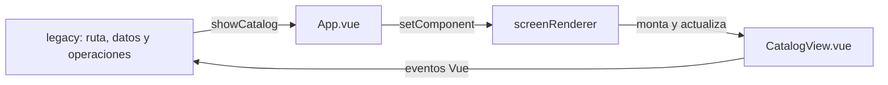

# TFI Veterinaria: primera vista Vue, etapa 3

Fecha: 18 de noviembre de 2026. Rama: `dev/benja`.

Se migró únicamente la pantalla de Catálogo a un componente Vue real. Las demás pantallas y los formularios de productos conservan su implementación anterior. No se realizaron commits, merges ni pushes, ni se comenzó la etapa 4.

## Revisión inicial y elección

Se revisaron Git, los informes de las etapas 1 y 2, `App.vue`, el renderizador, la selección de pantallas y las operaciones relacionadas con Catálogo y Avisos. Git estaba limpio al comenzar esta etapa, en el commit `f069d08`.

Se eligió **Catálogo** porque tiene una sola ruta, `products`, y sus acciones reutilizan formularios ya existentes. Avisos tiene más contextos: su pantalla también se integra en Configuración y sus datos se utilizan en la ficha de mascota. Migrar Catálogo permite comprobar la integración con un alcance menor.

Antes de editar se ejecutaron las pruebas y la compilación. Pasaron las 20 pruebas existentes y los cuatro scripts de regresión, con 32 escenarios correctos en la auditoría. La compilación habitual falló por el permiso de esbuild ya documentado; la alternativa con cargador nativo compiló correctamente.

## Cómo funcionaba y cómo funciona ahora

Antes, `catalog()` generaba toda la pantalla como una cadena HTML. `renderContent()` elegía esa cadena y `screenRenderer.setHtml()` la convertía en nodos Vue. Los campos y botones llegaban al delegado de eventos de `App.vue` mediante sus identificadores y atributos `data-action`.

Ahora, `catalog()` prepara los datos, los permisos y las acciones, pero ya no fabrica HTML. Entrega esos valores a `ui.showCatalog()`, que `App.vue` conecta con el componente `CatalogView.vue`. La vista construye su contenido con `<template>`, `v-for`, `v-if`, interpolaciones y eventos Vue.



El componente no usa `v-html` ni interpreta una cadena con el catálogo anterior. No tiene un segundo sistema de navegación ni consulta directamente `localStorage`.

## Estructura resultante y archivos

La estructura preparada en la etapa 2 se mantiene. La única vista nueva es:

```text
src/
  App.vue
  components/shared/ToastMessage.vue
  views/
    catalog/
      CatalogView.vue
  legacy/
    veterinaryApplication.js
    screenRenderer.js
  data/                       # Sin cambios
  services/                   # Sin cambios
  styles/                     # Sin cambios
tests/
  catalogView.test.js
  catalogIntegration.test.js
  screenRenderer.test.js
  helpers/loadVueComponent.js
  validation.test.js           # Sin cambios
  samplePractice.test.js       # Sin cambios
```

También se conserva `src/main.js`, junto con los demás archivos y recursos del proyecto.

| Archivo | Trabajo realizado |
| --- | --- |
| `src/views/catalog/CatalogView.vue` | Nueva vista real del catálogo, con propiedades y eventos. Conserva la estructura de encabezado, filtros y tarjetas. |
| `src/App.vue` | Agrega la importación de `CatalogView` y la conexión `showCatalog`. Su template, ciclo de vida y eventos anteriores permanecen iguales. |
| `src/legacy/veterinaryApplication.js` | Cambia únicamente `catalog()` y la selección de esa ruta en `renderContent()`. Se reutilizan los permisos, filtros, formato monetario y operaciones anteriores. |
| `src/legacy/screenRenderer.js` | Agrega `setComponent()` y comparte la preparación y limpieza de contenedores con `setHtml()`. |
| `scripts/audit-system.mjs` | Adapta el entorno de prueba para renderizar el componente real con Vue y esperar ese resultado. No cambia sus escenarios, datos ni comprobaciones. |
| `tests/catalogView.test.js` | Cinco pruebas del template real, presentación, propiedades reactivas y eventos. |
| `tests/catalogIntegration.test.js` | Cinco pruebas del módulo real y su comunicación con la vista. |
| `tests/screenRenderer.test.js` | Una prueba de actualización de instancia, desmontaje antes de reemplazar el padre y limpieza final. |
| `tests/helpers/loadVueComponent.js` | Compila el `.vue` para las pruebas usando las herramientas que ya incluye Vue, sin archivos temporales ni nuevas dependencias. |
| `README.md` | Documenta la primera vista, el puente temporal y las verificaciones. |
| `reports/etapa-3-primera-vista-vue.md` | Este informe. |

No se crearon componentes hijos: en este catálogo no aportaban una separación necesaria. `ToastMessage.vue` sigue siendo el componente compartido de notificaciones, sin cambios.

## Organización de CatalogView.vue

El `<script setup>` declara las propiedades que recibe y los cinco eventos que puede emitir. El `<template>` define el HTML de la pantalla y utiliza los datos recibidos para mostrar productos, opciones, estados y botones.

| Propiedad | Para qué sirve |
| --- | --- |
| `clinicName`, `clinicPhone` | Encabezado y contacto que ya se mostraban. |
| `products` | Productos ya filtrados según permisos, búsqueda y categoría. |
| `categories` | Opciones de categoría, conservando el orden y origen anteriores. |
| `canManage` | Indica si se deben mostrar los controles administrativos. |
| `query`, `category` | Valores vigentes de los filtros. |
| `formatMoney` | Reutiliza la función existente de formato monetario. |

Las propiedades son reactivas dentro de Vue. Al recibir nuevos valores, Vue actualiza el template. No se agregaron `ref` o `computed` sin necesidad: la búsqueda, la categoría, la base y la ruta ya tienen una autoridad en el módulo anterior. Copiarlas a un segundo estado local podría hacer que se desincronicen al guardar o cambiar de pantalla.

La vista no modifica productos ni decide roles. Recibe datos y comunica intenciones:

| Evento | Resultado en el código existente |
| --- | --- |
| `search(texto)` | Actualiza la búsqueda y entrega nuevas propiedades a la vista. |
| `filter(categoria)` | Actualiza la categoría y entrega nuevas propiedades. |
| `create()` | Ejecuta la acción existente que abre el formulario de producto. |
| `edit(id)` | Abre el formulario existente para ese producto. |
| `toggle(id)` | Abre la confirmación existente de activación o desactivación. |

Los formularios continúan validando y guardando con las funciones anteriores. Sus resultados actualizan nuevamente el catálogo. Las promesas de las acciones mantienen el manejo de errores mediante las notificaciones existentes.

## Cómo convive con las pantallas anteriores

`route`, `navigate()`, `shell()` y los permisos continúan en el mismo módulo. No se agregó otra ruta ni un estado de navegación en `App.vue`.

Cuando la ruta es `products`, `renderContent()` llama a `catalog()` y termina esa ejecución con `return`. Así no llama después a `setHtml()` sobre el mismo contenido y no reemplaza accidentalmente la vista nueva.

`setComponent()` monta el componente mediante `h()` y `render()`, de Vue. Utiliza el mismo registro de contenedores que ya tenía el adaptador. Cuando `shell()` reemplaza `#app`, primero se desmonta la vista registrada dentro de `#content`. Al pasar de un componente a HTML en el mismo contenedor, Vue realiza el desmontaje correspondiente.

Las actualizaciones del catálogo no agregan una clave aleatoria al componente. Eso permite reutilizar su instancia y conservar el nodo del campo de búsqueda, en lugar de reconstruirlo en cada carácter. Las pruebas confirman esa identidad de instancia y nodo; el foco y cursor reales quedan pendientes de navegador.

Los eventos nuevos usan `.stop`: `@input.stop`, `@change.stop` y `@click.stop`. Los identificadores `list-search` y `list-filter`, y los atributos `data-action` y `data-id`, se conservan. Frenar la propagación evita que el delegado antiguo procese otra vez la misma interacción.

Las modificaciones por guardado, activación y evento `storage` siguen leyendo la base vigente y entregan propiedades nuevas. No se guarda una copia independiente de los productos en la vista.

## Funcionalidad y diseño conservados

- Administrador y superadministrador ven todos los productos y pueden gestionar mediante los formularios anteriores.
- El propietario consulta únicamente productos activos y no puede ejecutar operaciones administrativas, aunque intente invocar sus callbacks.
- El veterinario sigue sin acceso a la ruta del catálogo.
- La búsqueda conserva la comparación sobre `JSON.stringify(product)` y la conversión a minúsculas en español. También puede encontrar datos que no se imprimen en la tarjeta, como antes.
- El filtro usa categoría exacta. Sus opciones siguen obteniéndose de todos los productos, incluidos los inactivos.
- Se mantienen el encabezado, contacto, textos, fotos, SVG de bolsa, precios ARS sin decimales, estados de stock y publicación, botones y mensaje vacío. No se agregó paginación.
- Se mantienen `.heading`, `.toolbar`, `.grid`, `.card`, `.product-img`, `.row`, `.badge`, `.small` y las demás clases necesarias, sin contenedores nuevos que alteren la estructura de las tarjetas.
- No se modificó ningún CSS ni se agregaron estilos al componente.

También se conservaron autenticación, roles, mascotas y propietarios, atenciones, historia clínica, tickets, cobros, agenda, avisos, notificaciones, datos demo y reglas de impresión. No cambiaron las claves ni estructuras de `localStorage`.

El QR continúa simulado. No se cambiaron identificadores de mascotas, códigos de cinco dígitos ni enlaces `#qr=...`, y no se instalaron bibliotecas ni funciones de cámara.

## Pruebas y compilación

En PowerShell se usó `npm.cmd`, equivalente a los comandos `npm` del proyecto.

| Verificación | Estado inicial | Estado final |
| --- | --- | --- |
| `npm test` | 20 correctas. | 31 correctas; 0 fallidas y 0 omitidas. |
| `npm run test:regression` | Los cuatro scripts correctos. | Los cuatro scripts correctos. |
| Auditoría incluida en regresión | 32 correctos, 0 hallazgos y 0 errores de ejecución. | 32 correctos, 0 hallazgos y 0 errores de ejecución. |
| `npm run build` | Fallo de permisos al cargar la configuración con esbuild. | El mismo fallo de permisos. |
| `npm run build -- --configLoader native` | Compilación correcta; 21 módulos. | Compilación correcta; 22 módulos, incluida la vista nueva. |
| `git diff --check` | Sin cambios pendientes al comenzar. | Sin errores de espacios. |

Las 11 pruebas nuevas cubren tres niveles:

1. **Vista real:** el archivo `.vue` se compila con las herramientas incluidas en Vue. Se comprueban el HTML generado, los textos escapados, imágenes, controles, estado vacío y eventos. Un renderizador en memoria comprueba actualizaciones de propiedades y que cada evento se emita una vez con su propagación detenida.
2. **Integración:** se ejecuta `startVeterinaryApplication()` con datos ficticios y se captura el contrato `showCatalog`. Se comprueban los cuatro roles, filtros, formularios, confirmaciones, guardado, navegación, cierre de sesión, `storage` y deshabilitación de la cuenta.
3. **Desmontaje:** el adaptador real utiliza el renderizador DOM de Vue sobre un árbol mínimo en memoria. Se comprueba que actualizar propiedades reutilice la instancia y que el hijo se desmonte antes de retirar su contenedor padre. También se comprueba `dispose()`.

La auditoría conserva sus comprobaciones anteriores. Solo se adaptó su entorno de prueba porque Catálogo ahora se entrega como componente en lugar de una cadena HTML. El catálogo que verifica se renderiza desde el `.vue` real, no desde una copia de la implementación anterior.

Se comprobaron 24 importaciones locales sin rutas rotas y la compilación resolvió el componente nuevo. También se comparó el módulo principal contra el commit inicial: los únicos bloques modificados son `catalog()` y la selección de `products` en `renderContent()`.

No se agregaron dependencias. `package.json`, `package-lock.json`, los servicios, los datos demo, los estilos, `main.js`, los recursos y la configuración de Vite permanecen sin cambios.

## Límites y revisión pendiente

Se intentó acceder al navegador de pruebas mediante Computer Use. La herramienta informó `The browser access host is unavailable`. No se realizó una revisión visual ni se abrió el perfil habitual del usuario.

Las pruebas usan almacenamiento y árboles de nodos en memoria. No leen ni modifican datos del navegador real. El árbol mínimo del adaptador no interpreta HTML arbitrario: esa prueba solo utiliza un reemplazo por contenido vacío para comprobar el desmontaje.

Queda pendiente verificar en un navegador aislado: apariencia de escritorio y móvil, foco y cursor durante la escritura, composición de texto, apertura y cierre visual de los diálogos y navegación completa. La conservación del HTML y CSS aporta evidencia sobre el diseño, pero no reemplaza esa revisión.

Se mantiene el problema de permisos de esbuild documentado en las etapas anteriores; no se modificó la configuración para ocultarlo. También continúa sin cambios la prueba antigua de agenda que depende parcialmente de noviembre de 2026.

## Próxima pantalla recomendada

Conviene continuar con **Avisos**, después de revisar esta migración. Antes de implementarla habrá que distinguir su pantalla de lectura y su uso dentro de Configuración, conservando publicación, expiración y operaciones administrativas.

El modelo de esta primera vista es: template propio, propiedades para mostrar datos, eventos para solicitar acciones y reutilización de las operaciones existentes. Las pantallas restantes pueden migrarse una por una, manteniendo el puente temporal hasta que deje de ser necesario. La extracción completa de lógica de negocio sigue correspondiendo a la etapa 4.

Esta entrega termina en la primera vista Vue. No se migró Avisos ni ninguna otra pantalla.
